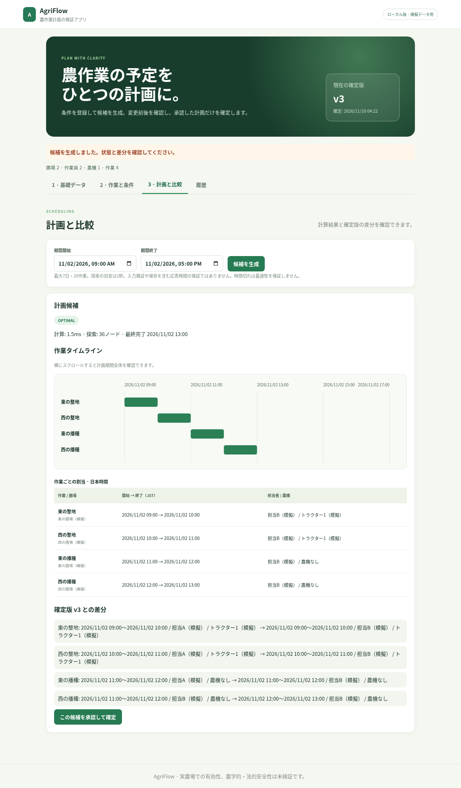

# AgriFlow

> 農作業の制約付きスケジューリングと再計画を行う実験的なWebプラットフォーム。

**状態:** Requirements Draft v0.1（未承認） / ローカルMVP実装あり / 実農場での価値検証未実施  
**用途:** 個人開発・技術学習・ポートフォリオ。初期は非商用、月額サービス利用費0円を原則とする。

## 提出版の実演と起動



担当者の欠勤を入力して再計画し、差分を確認してから承認できます。旧版は履歴に残ります。
Node.js / TypeScript、PostgreSQL17、worker thread、Docker Composeで実装。公開用認証はなく、ローカル・模擬データ専用です。

```sh
node scripts/configure.mjs
docker compose up --build -d --wait
docker compose exec -T app node scripts/seed.mjs
```

http://127.0.0.1:3000 を開く。seedは空DBのみ、期間は2026-11-02 09:00〜17:00 JST。停止は `docker compose down`（データ保持）。Nodeの代わりに.env.exampleから.envを作る手順、JSON移行/復元/障害対応は[運用手順](docs/OPERATIONS.md)。検証はLinux Docker Engine/Composeで実施し、Docker Desktopや実スマホでの再現は未検証です。

| 提出資料 | 内容 |
|---|---|
| [実演台本](docs/DEMO.md) | 計画→欠勤→再計画→承認→履歴を5分で説明 |
| [構成とER図](docs/design/ARCHITECTURE.md) / [API](docs/design/API.md) | worker・DB・版管理とHTTP契約 |
| [ADR-0004](docs/adr/0004-postgres-compose.md) | PostgreSQL/SQLite、transaction、Composeの判断 |
| [提出版の検証](docs/testing/PORTFOLIO_RESULTS.md) | PF-01〜13、CI・テスト・性能・復元の証拠と限界 |
| [スマホ幅の実画面](docs/screenshots/replan-390.png) | Chromium390px。実スマホ撮影ではない |

外部サービスの月額利用料0円。DB・計算はローカル、実行時の外部API/キー不要。Docker等の利用条件、電気・通信費は別途確認してください。製品要件v1.0は未承認、実農場の価値・農学的安全性は未検証です。

## 何を解決するか（仮説）
複数圃場に分散した作業を、人員・農業機械・作業可能時間・期限などの制約のもとで整合的に計画する。欠勤・機械利用不可などの変更があれば再計画し、その結果と変更前後の差分を人が確認できるようにする。

現段階で「農業現場で実際に最も困っている課題」と確認済みではない。業務課題と利用者像は仮説であり、プロトタイプとヒアリングで検証する。

## MVP（案）
- 1つの農場で圃場・作業員・機械・作業・利用可能時間を登録する。
- 最大7日間のスケジュールを作り、必須制約（資源重複禁止、期限など）を満たす解を探索する。作業順序は試験的機能として扱う。
- 制約により解が見つからない、最適性が証明されない等を区別して表示する。
- 欠勤などによる再計画、旧案との差分確認、ユーザー承認後の確定、履歴保存に対応する。
- ブラウザから操作でき、自動テスト付きでローカルで再現可能にする。

## Nodeによる互換JSON版の起動と検証

Node.js 22以上とnpmを用意し、リポジトリのルートで実行します。Windows PowerShellの実行制限がある場合は `npm` を `npm.cmd` に置き換えてください。

```sh
npm ci
npm run typecheck
npm test
npm run demo
npm run benchmark
npm start
```

`npm ci` はlockfileで固定した依存（TypeScript/pg/Playwright等）の取得に初回ネット接続が必要です。実行時の外部API・月額サービス・APIキーは不要です。
`npm start` はビルド後に既存MVPを起動します。[ローカル画面](http://127.0.0.1:3000)を開き、終了はCtrl+C。
操作は[APP_USAGE.md](APP_USAGE.md)、計算APIの型は[src/scheduler/model.ts](src/scheduler/model.ts)、入口は[src/scheduler/solve.ts](src/scheduler/solve.ts)。
`npm run demo` はSC-001の模擬データを計算し、OPTIMAL・11:00 JSTの完了時刻をJSONで出力します。

### Phase 1時点の品質と範囲（過去記録）

既存Draft PR #2のMVPを再利用し、計算部をstrict TypeScriptに分離しました。1農場・最大7日・30分・最大20作業は検証用の暫定仕様です。
期間/期限、作業員・農機・圃場の排他、利用可能時間、作業不可時間、先行関係を検査します。
結果はOPTIMAL / FEASIBLE / INFEASIBLE / UNKNOWN。入力不正はInputError、内部異常は例外で通知します。
既定の2秒/300,000ノード上限は協調的な停止であり、厳密な応答時間保証ではありません。

28件のテスト（独立した81ケースの最適値比較を含む）がローカルで成功。
20作業の測定では約2秒でFEASIBLEとなり、最適性は未証明です。詳細は[検証記録](docs/testing/PHASE1_RESULTS.md)。
[ADR-0001](docs/adr/0001-scheduler-phase1.md)に計算量、正確性の根拠、入力契約、代替案を記録しています。
[Phase 2 Web基本設計](docs/design/PHASE2_WEB.md)と[ADR-0002](docs/adr/0002-phase2-web-design.md)は当時の設計です。現在の提出版で実装・検証した範囲は上記の提出版検証を参照してください。
公開運用・実農場での利用は未検証です。

## 要件定義ドキュメント

| ファイル | 目的 |
|---|---|
| [Vision](docs/product/VISION.md) | 課題仮説、対象ユーザー、提供価値、成功条件 |
| [PRD](docs/product/PRD.md) | MVPの利用シーン、範囲、ビジネス要件 |
| [SRS](docs/requirements/SRS.md) | ID付き機能・非機能要件と受け入れ条件 |
| [ユースケース](docs/requirements/USE_CASES.md) | 利用者の操作フロー、例外、確認シナリオ |
| [最小テストシナリオ](docs/requirements/EXAMPLE_SCENARIOS.md) | 既知解・解なし・変更後の動作例 |
| [トレーサビリティ](docs/requirements/TRACEABILITY.md) | 目的→要求→検証項目の対応 |
| [未決事項](docs/requirements/OPEN_QUESTIONS.md) | 仮説、リスク、次の検証 |
| [Issue #1レビュー結果](docs/requirements/REVIEW_FINDINGS.md) | 実装時の作業仮定と未検証事項 |
| [要件レビュー](docs/requirements/REVIEW_CHECKLIST.md) | 要件定義のレビュー・承認条件 |
| [根拠と情報源](docs/research/SOURCES.md) | 外部公開資料、調査上の限界 |
| [決定ログ](docs/DECISIONS.md) | 暫定決定、技術選定は未確定とする履歴 |

## 開発・公開ルール
1. 要件は `BR-`（事業・目的）、`FR-`（機能）、`NFR-`（非機能）、`AC-`（受け入れ）などの識別子で追跡する。
2. **事実／仮説／設計上の仮定／決定**を混同しない。採用技術やクラウドは、要件を検証してからADRで決める。
3. 実農場データ、個人情報、APIキー、秘密の設定値をコミットしない。
4. 月額0円を目標に無料枠内で運用する。クラウド無料枠の変化や電気・通信費は別扱い。
5. 重要な仕様変更はIssueに理由と影響を書き、Pull Requestで差分をレビューする。

## 次のゲート
- 提出版PRのレビューと統合承認、未承認業務ルールの具体化、実ユーザーへの仮説検証。
- 要件のレビューが完了するまで、開発期間・技術構成・データモデルを「確定」とはしない。

## ライセンス
未決定（OQ-013）。ユーザーによる選定が必要。ライセンスファイルがない限り、一般に自由利用を許諾する意味にはならない。
