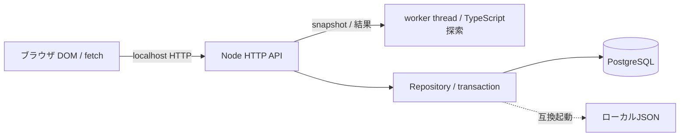
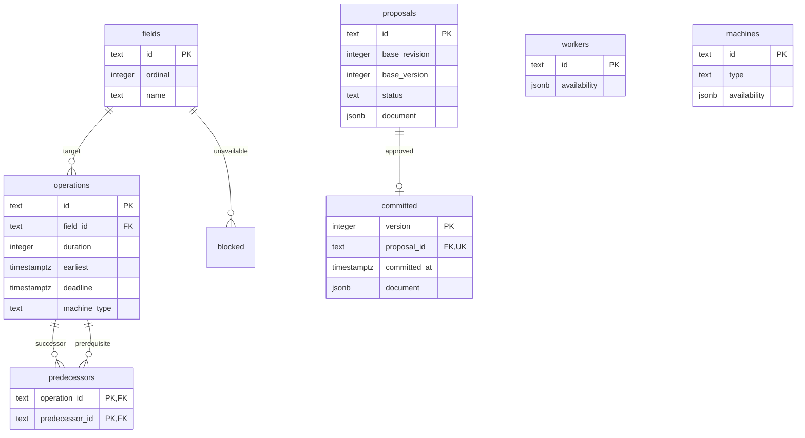

# 提出版の構成・データ設計

関連: ADR-0001/0002/0004、PF-07/12。製品v1.0承認ではない。

appコンテナ内は0.0.0.0で受け、ホストの127.0.0.1だけへ公開する。DBはCompose内部のみ。PUBLIC_ORIGINに対応するHost/Originを検査する。直接Node起動はloopback限定。認証/認可は未実装で公開サービスとしては使わない。

farm_stateは1行の農場名称/revisionと承認・更新のロック対象。schema_migrationsは適用版を持つ。配列順はordinalで保存しimport時に維持。利用可能区間は小規模PoCなのでJSONB、作業と先行関係はFKで保護する。machine_typeは要求する種類であり、未登録の場合は計算でINFEASIBLEとなるため機械IDのFKにはしない。

候補documentは入力snapshot/期間/結果/作成日時/base版を保持する。確定版documentはそれにversion/committedAtを加えたもの。過去履歴から現行資源へのFKを張らず、削除・名称変更後も当時の内容を表示する。Repositoryは旧候補/確定版の改変・削除を拒否する。

計算前に状態を読み、workerで入力検証・探索・独立検査を行う。結果保存時にrevisionと確定versionを再照合。承認はFOR UPDATEで最新状態を読み、古い候補・実行不能候補を拒否して再検査し、次のversionを同一transactionで追記する。保存失敗はrollback。計算中に別リクエストでstateを読める。

現行エンティティ全再挿入、全履歴の読込は小規模限定。ページング、増分更新、多人数アクセス、DB権限分離、監視集約は今後の課題。UTC ISO保存/JST表示、30分slot、最大7日/20作業は現行モデルの制限であり製品確定値ではない。
